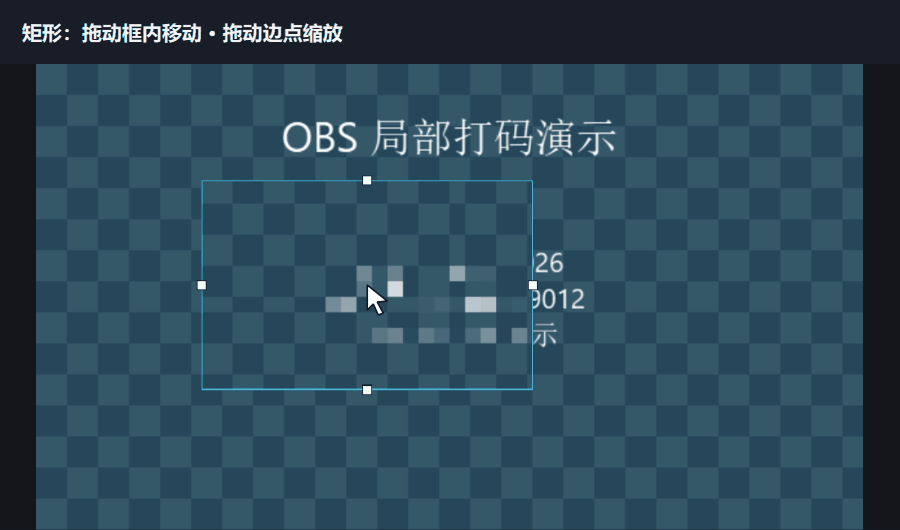
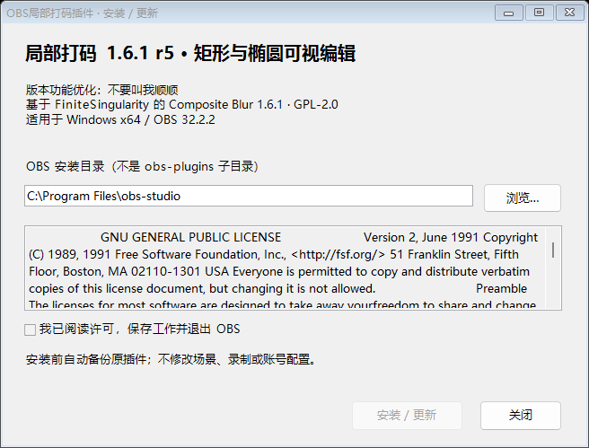
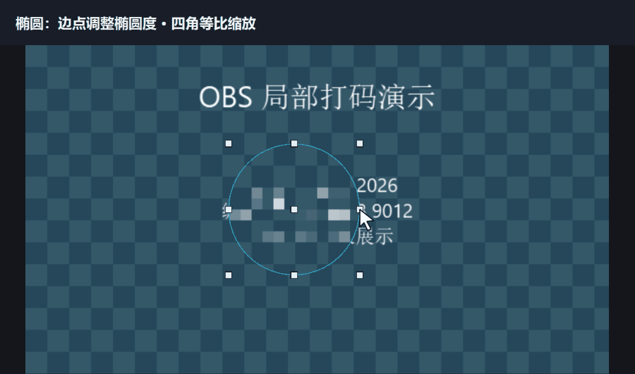
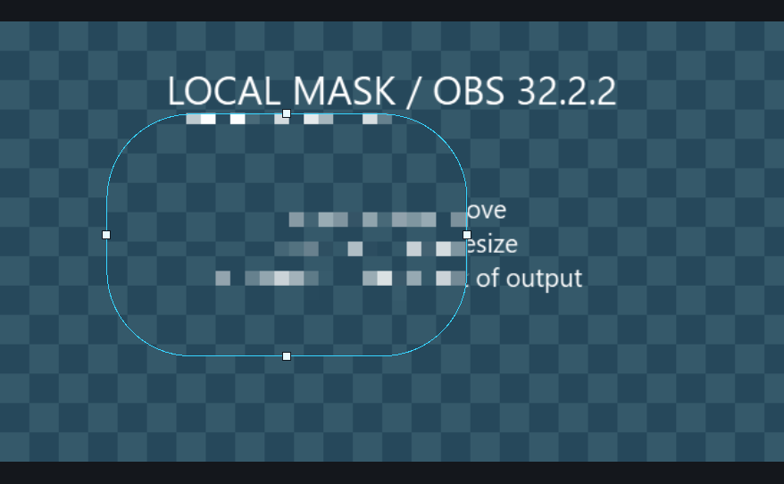

**[下载 Windows x64 双击安装版 EXE（推荐，无需解压）](https://github.com/BUYAOJIAOWOSHUNSHUN/obs-local-blur/releases/download/v1.6.1-local-r5/obs-local-blur-1.6.1-local-r5-setup-x64.exe)**

[手动安装 ZIP](https://github.com/BUYAOJIAOWOSHUNSHUN/obs-local-blur/releases/download/v1.6.1-local-r5/obs-local-blur-1.6.1-local-r5-windows-x64.zip) · [SHA-256 校验](https://github.com/BUYAOJIAOWOSHUNSHUN/obs-local-blur/releases/download/v1.6.1-local-r5/SHA256SUMS.txt) · [更新说明与历史版本](https://github.com/BUYAOJIAOWOSHUNSHUN/obs-local-blur/releases/tag/v1.6.1-local-r5)

v1.6.1-local-r5 · Windows x64 · OBS Studio 32.2.2

# OBS局部打码插件

**在 OBS 预览里拖动框选，调整矩形或椭圆打码区域。**

适用于直播、录屏中的局部遮挡。移动、缩放范围时实时查看效果，辅助框和白色控制点只在滤镜编辑预览中显示，不进入录制与直播输出。



[查看矩形静态预览](.github/assets/rectangle-drag-poster.png)

> 动图使用合成示例内容，由已发布插件在独立 Qt/libobs/D3D11 窗口中接收拖动事件并逐帧渲染。鼠标指示和顶部说明为演示叠加；没有录制用户桌面。实际 OBS 主题与窗口布局可能不同。

## 基于什么项目，优化了什么

本项目基于 **[FiniteSingularity](https://github.com/FiniteSingularity)** 开发的 **[Composite Blur 1.6.1](https://github.com/finitesingularity/obs-composite-blur/)** 修改，由 **[不要叫我顺顺](https://space.bilibili.com/40900884)** 进行中文界面、范围编辑和安装体验优化。原项目提供模糊算法与蒙版渲染，本项目保留原作者信息和 GPL-2.0 许可，完整公开修改后的源码，是独立衍生版本。

| 使用时的变化 | 本版提供的操作 |
| --- | --- |
| 直接在预览里框选 | 拖动框内移动，拖动边点调整范围，Esc 取消当前拖动 |
| 矩形和圆角矩形 | 细边框实时匹配圆角，保留四边中点手柄 |
| 圆形和椭圆 | 九个白点：四角等比缩放、四边调整宽高、中心移动；Shift 保持比例 |
| 一键恢复正圆 | 保持中心，以当前较短半径统一横纵半径 |
| 参数更好找 | 上方“模糊区域参数”，下方“马赛克样式参数”；拖动后不再主动重建整块参数面板 |
| 中文显示与安装 | 效果滤镜名称为“局部打码”；提供无需解压的 EXE 安装器，安装前自动备份 |

蒙版选项精简为 **无、矩形、圆形 / 椭圆**，新滤镜默认为矩形。仍可使用原项目提供的高斯、方框、多级、时间模糊和像素化算法，以及对应的参数。

## 安装与第一次使用

### 1. 退出 OBS，双击安装

在顶部下载页选择 **`setup-x64.exe`**。保存工作并退出 OBS，双击运行安装器；确认 OBS 安装根目录，阅读许可并勾选确认，点击“安装 / 更新”。无需解压 ZIP。



支持 **Windows x64 / OBS Studio 32.2.2**，可检测标准版与 Steam 版路径；找不到时选择含 `bin/64bit/obs64.exe` 的 OBS 根目录。安装器会请求管理员权限，拒绝 OBS 运行中安装，备份位置为 OBS 根目录下的 `obs-local-blur-backups`。不修改场景、录制或账号配置。若装有多个 OBS，请核对显示的目录，必要时点击“浏览”切换。DLL 安装到 `obs-plugins/64bit`，资源安装到 `data/obs-plugins/obs-composite-blur`。

EXE 使用 Windows 的 .NET Framework 4.x，不需要另装现代 .NET Desktop Runtime。EXE 和 DLL 未做代码签名，下载后可用同一 Release 的 `SHA256SUMS.txt` 核对完整性。

### 2. 给来源添加“局部打码”

在 OBS 的“来源”列表中右键需要处理的来源 → **滤镜** → 效果滤镜下方 **＋** → **局部打码**。在“模糊区域参数”中选择矩形或圆形 / 椭圆。

### 3. 拖动预览框，确定范围

- **矩形：** 拖动框内移动；拖动四边白点改变宽高，角部也可以拖动缩放。
- **圆形 / 椭圆：** 四角等比缩放，四边白点分别改变宽高，中心白点或框内用于移动。按住 Shift 拖动边点可保持当前比例。
- **恢复正圆：** 点击参数区的“恢复正圆”；中心不变，横纵半径取当前较短值。
- **取消操作：** 拖动过程中按 Esc。



边点先把正圆拉成椭圆，再演示角点等比缩放；两段动图会循环播放。[查看椭圆静态预览](.github/assets/ellipse-resize-poster.png)

### 4. 调整样式，检查输出

矩形的“圆角半径”会同步改变边框轮廓；“羽化”调整边缘过渡，“反转蒙版”用于处理范围外区域。在下方“马赛克样式参数”中选择算法、像素化样式及强度。



调整后检查最终画面是否已充分遮挡目标内容。完成设置可关闭滤镜编辑窗口，效果继续生效。

## 升级前需要知道

- 已有滤镜及自定义名称沿用；旧“裁剪”在界面中改称“矩形”，内部设置键不变。
- 旧矩形蒙版迁移到矩形范围；旧圆形单半径设置继续保持正圆。
- 旧“源 / 图片”蒙版会改为矩形，背景合成功能已停用。使用过这些功能的场景，升级后需要重新核对范围和最终输出。
- 可视编辑器只对已验证的 OBS **32.2.2** 启用，安装器也会检查此版本。其他 OBS 版本与非 Windows 平台未验证。

### 手动安装与回退

手动 ZIP 用户：先退出 OBS 并备份原插件，再把 ZIP 中的 `obs-plugins`、`data` 合并复制到 OBS 安装根目录。**不要只替换 DLL：椭圆功能也需要新版着色器。** GitHub 自动生成的 **Source code** 压缩包是源码，不是可安装插件。

回退时退出 OBS，将对应备份目录的原文件复制回原位置；`files.txt` 的 `restore` 表示原有文件，`new` 表示本次新增文件。安装器遇到普通安装异常会尝试自动回退；断电、强制终止或并发修改目标目录不保证自动恢复。

## 性能与验证

滤镜会增加 GPU 负担，分辨率、算法、参数及滤镜数量都会影响开销。本版复用椭圆边框坐标，无滤镜窗口时降低后台检查频率，最小化时暂停辅助预览，关闭窗口时释放预览。

RTX 4070、1080p 合成源的单次测试中，马赛克、高斯与多级模糊的 GPU 渲染耗时中位数约为 **0.10 / 0.12 / 0.33 ms**。这是特定参数下的单源测试，不含游戏或编码，也不是整机占用百分比。与 r4 相比常规渲染耗时接近，不宣称显著提速。

- r5 已由作者在实际 OBS 中完成界面与交互验收。
- 发布插件通过 **91 项**独立 Qt/libobs/D3D11 检查，安装器通过 **16 项**虚拟目录安装、备份、回退和路径保护检查。
- 发布前的源码、敏感信息与安装包检查范围及限制见 [SECURITY.md](SECURITY.md)。

## 源码与许可

原说明保存在 [README.upstream.md](README.upstream.md)，修改记录见 [CHANGELOG.md](CHANGELOG.md)，许可见 [LICENSE](LICENSE)。

已验证的本地工具链：MSVC 14.44、Windows SDK 10.0.26100.0、Qt 6.11.1、OBS 32.2.2 头文件及 OBS 安装目录。工具链不随仓库分发，CMake 和跨平台构建未验证。

```powershell
./build-local.ps1 -Dependencies <依赖目录> -ObsBin <OBS安装目录/bin/64bit> -BuildDirectory <构建目录> -PackageDirectory <插件输出目录>
./tests/run-local-tests.ps1 -Dependencies <依赖目录> -ObsRoot <OBS安装目录> -BuildDirectory <构建目录> -PackageDirectory <插件输出目录> -ReviewDirectory <新的检查目录>
./installer/build-installer.ps1 -PackageDirectory <插件输出目录> -BuildDirectory <新的安装器构建目录> -OutputDirectory <安装器输出目录>
```

依赖目录按脚本约定放置 `10.msvc-bootstrap/msvc`、`obs-qt6-20260715`、`obs-studio` 与 `llvm-mingw-20261006-ucrt-x86_64`。前两者分别提供 MSVC/Windows SDK、Qt include/lib；后两者提供 OBS 头文件和 `llvm-readobj`。可按实际工具链位置调整脚本。
