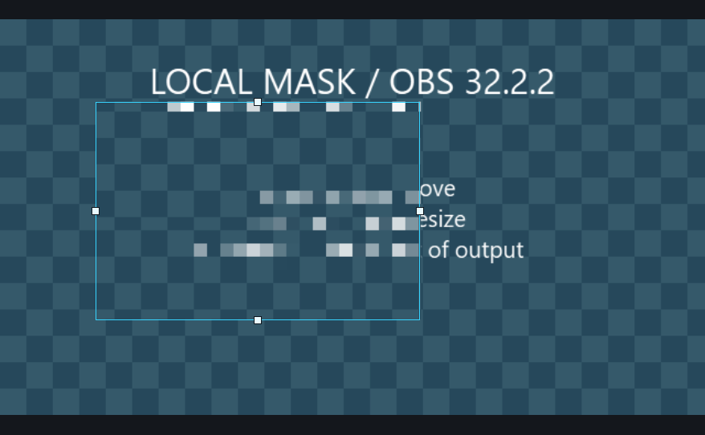

# OBS局部打码插件

## 下载 v1.6.1-local-r4

Windows x64 · OBS 32.2.2 · Composite Blur 1.6.1 可视裁剪与安全修复版

- **[双击安装版 EXE（推荐，无需解压）](https://github.com/BUYAOJIAOWOSHUNSHUN/obs-local-blur/releases/download/v1.6.1-local-r4/obs-local-blur-1.6.1-local-r4-setup-x64.exe)**
- [手动安装版 ZIP](https://github.com/BUYAOJIAOWOSHUNSHUN/obs-local-blur/releases/download/v1.6.1-local-r4/obs-local-blur-1.6.1-local-r4-windows-x64.zip)
- [SHA-256 校验文件](https://github.com/BUYAOJIAOWOSHUNSHUN/obs-local-blur/releases/download/v1.6.1-local-r4/SHA256SUMS.txt)
- [更新说明与历史版本](https://github.com/BUYAOJIAOWOSHUNSHUN/obs-local-blur/releases)

GitHub 自动生成的 Source code 压缩包是源码，不是安装程序。旧 r3 及更早修改版存在继承的长图片路径内存安全缺陷，建议使用 r4。

## 简介

用于 OBS 直播和录制的局部模糊、打码插件，可以直接在来源滤镜的预览画面上移动、缩放作用范围。

本项目基于 **[FiniteSingularity](https://github.com/FiniteSingularity)** 创作的 **[Composite Blur v1.6.1](https://github.com/finitesingularity/obs-composite-blur/)** 修改优化。原插件提供模糊算法和蒙版处理；本修改版由 **[不要叫我顺顺](https://space.bilibili.com/40900884)** 优化中文显示、可视裁剪交互及安装体验。

完整源码公开，保留上游 GPL-2.0 许可和作者信息。本项目是独立衍生修改版，并非上游官方发布。原说明见 [README.upstream.md](README.upstream.md)，许可见 [LICENSE](LICENSE)。

### 相比原项目优化了什么

- 滤镜中文名称改为“局部打码”。
- 裁剪蒙版的上、下、左、右参数整合到预览范围框：拖动框内移动，拖动边角缩放，Esc 取消本次拖动。
- 细边框实时匹配圆角参数，保留四边中点白色手柄，隐藏四角方块和常驻操作说明。
- 保留羽化、反转与已有裁剪设置，辅助框不会进入录制或直播输出。
- 新增双击安装程序：自动查找标准版 / Steam 版 OBS，安装前备份原插件，复制失败时尝试恢复。
- 修复原版继承的长图片路径固定缓冲区越界问题。

## 简单使用说明

下面使用合成示例画面演示。预览图来自独立 Qt/libobs 测试窗口的实际渲染；不是用户直播画面，实际 OBS 主题和控件排列可能不同。

### 1. 双击安装

保存工作并退出 OBS，运行上方 EXE。安装程序会请求管理员权限，自动查找 OBS 目录；未找到时点击“浏览”，选择含 `bin/64bit/obs64.exe` 的 OBS 根目录。阅读许可、勾选确认后点击“安装 / 更新”。


安装器只接受 OBS 32.2.2。原插件备份放在 OBS 根目录的 `obs-local-blur-backups`，不修改场景、账号或录制配置。此包没有代码签名；请从本仓库下载并核对校验值。安装器依赖 Windows 的 .NET Framework 4.x，不要求另装现代 .NET Desktop Runtime。

### 2. 添加滤镜，选择裁剪蒙版

打开 OBS，在“来源”列表中右键需要处理的来源 → “滤镜” → 效果滤镜下方“+” → “局部打码”。在插件的效果蒙版选项中选择“裁剪”。已有 Composite Blur 滤镜沿用原设置，自定义滤镜名称保留。

### 3. 拖动框选需要打码的区域

在上方预览中拖动框内可移动位置；拖动四边白色方块可调整宽高，拖动角部也可以缩放。调整期间会实时更新作用范围；按 Esc 可取消当前拖动。



### 4. 调整圆角与效果强度

调节“圆角半径”会同步改变辅助框轮廓；调节“羽化”让边缘过渡柔和。需要处理框外区域时勾选反转。再根据内容调整模糊半径或选择所需算法、像素化样式；使用前检查最终画面中的敏感内容是否已充分遮挡。


### 5. 查看项目和作者

滤镜底部的三个蓝色下划线链接分别打开本仓库、优化作者哔哩哔哩主页和原项目。


## 手动安装与回退

ZIP 用户：先退出 OBS，备份原插件 DLL 和数据目录，再将压缩包中的 `obs-plugins`、`data` 合并复制到 OBS 安装目录。

回退时退出 OBS，将安装器生成的备份目录中的对应文件复制回 OBS 根目录。`files.txt` 标明原有文件和本次新建文件。自动回退针对可捕获的安装异常，不能保证断电或进程被强制结束时自动完成恢复。

## 验证与安全

验证目标为 **Windows x64 / OBS 32.2.2 / Qt 6.11.1**；其他版本未验证，可视裁剪编辑器仅对 OBS 32.2.2 启用。

- 基础拖拽已由用户在实际 OBS 中验收。
- r4 插件编译与 58 项独立 Qt/libobs/D3D11 检查通过，包括长 UTF-8 路径更新。
- 安装器 16 项虚拟目录检查通过，包括包校验、路径范围、备份、失败回退和硬链接保护。
- 安装界面已做离屏渲染检查；未将测试宣称为每台电脑的 UAC / 双击实机验收。
- 隐私与安全审查范围、修复及限制见 [SECURITY.md](SECURITY.md)。

## 从源码构建

已验证插件构建入口：`build-local.ps1`；回归入口：`tests/run-local-tests.ps1`。需要 MSVC 14.44、Windows SDK 10.0.26100.0、Qt 6.11.1、OBS 32.2.2 头文件和目标 OBS 安装目录。工具链不随仓库分发；CMake 与非 Windows 构建未验证。

```powershell
./build-local.ps1 -Dependencies <依赖目录> -ObsBin <OBS安装目录/bin/64bit> -BuildDirectory <构建目录> -PackageDirectory <输出目录>
./tests/run-local-tests.ps1 -Dependencies <依赖目录> -ObsRoot <OBS安装目录> -BuildDirectory <构建目录> -PackageDirectory <输出目录> -ReviewDirectory <测试输出目录>
./installer/build-installer.ps1 -PackageDirectory <插件输出目录> -BuildDirectory <新的安装器构建目录> -OutputDirectory <安装器输出目录>
```

依赖目录布局沿用构建脚本：`10.msvc-bootstrap/msvc` 内包含 `VC/Tools/MSVC/<版本>` 和 `Windows Kits/10`；`obs-qt6-20260715` 内为 Qt 6.11.1 的 include/lib；`obs-studio` 内为 OBS 32.2.2 的 libobs/deps；`llvm-mingw-20261006-ucrt-x86_64/bin/llvm-readobj.exe` 用于读取导出。目录名是构建约定，可自行调整脚本。
